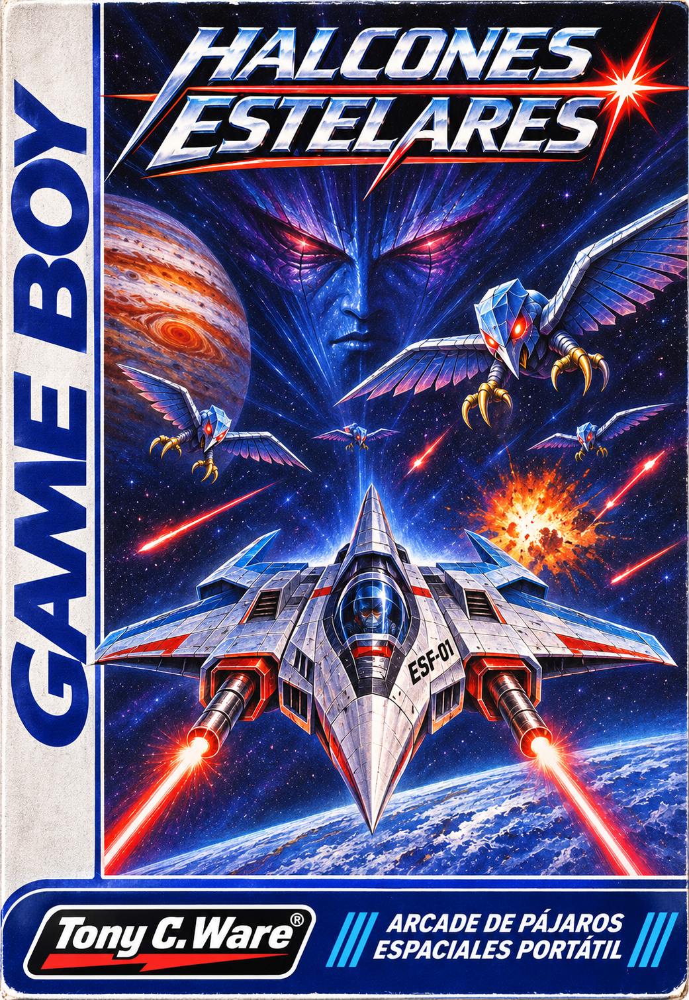

# HALCONES ESTELARES — GAME BOY

**Edición definitiva v0.18 · Game Boy clásica (DMG) · © 2026 Tony C. Ware**

*Arcade de pájaros espaciales portátil.* Adaptación nativa de **Halcones Estelares 1.3.3** para ZX Spectrum 48K, desarrollada con GBDK 4.4. No es un emulador de Spectrum.

## Historia original

**1988. El futuro.**

La recién formada **Fuerza Espacial Europea**, una facción secreta de los servicios de protección de Europa, detecta señales de radio y pulsos de energía que provienen de **Europa, la luna de Júpiter**.

Tras perder el contacto con varias sondas enviadas para investigar, llegó el momento de estrenar el **ESF-01**, el caza espacial más poderoso del mundo.

Nadie esperaba lo que se encontraron en el vacío sideral.

**Aves cósmicas con el único propósito de invadir, destruir y COMER.**

¿Pero qué o quién las dirige?

**Sube a bordo del ESF-01, piloto. Es el momento de luchar.**

*Sus gritos se oirán en el Cosmos.*

Historia original: **Tony C. Ware**, © 2026. **Halcones Estelares** constituye la antesala temática del universo de **Contacto 2010**. El misterio se desarrolla dentro del propio juego; no se atribuye un origen inventado al MOAI MONOLITH.

## Descargar y jugar

[**ROM oficial de Game Boy v0.18**](rom/Halcones-Estelares-GB-0.18.gb) — 32 KiB, sin MBC ni SRAM. Funciona en emuladores de Game Boy clásica y cartuchos flash compatibles. El récord no se guarda al apagar.

| Control | Acción |
|---|---|
| Cruceta izquierda/derecha | Mover la ESF-01 |
| A | Disparar; se puede mantener pulsado |
| B | Escudo (unos 3 s de protección y 6 s de recarga) |
| START | Comenzar, pausar y reanudar |

**Tres vidas** iniciales, un máximo de dos disparos propios simultáneos y puntuación máxima de 99.990. Los enemigos y los impactos al MOAI valen 10 puntos; se puede conseguir una vida extra cada 100 impactos, sin superar las tres vidas.

Hay **siete patrones de ataque** inspirados en Galaxian, Galaga, Moon Cresta, Phoenix y Space Invaders, incluyendo CROW que se retiran y reagrupan. El **MOAI MONOLITH** posee resistencia creciente e invoca refuerzos.

## Edición definitiva: Cañón de Plasma

El único cambio respecto al juego anterior aprobado es el sonido del disparo de la ESF-01: un **chasquido eléctrico** seguido de un **soplido grave y seco**. Se sintetiza con dos etapas de ruido en el canal 4 de Game Boy; no hay pitido agudo. Se conserva exactamente el binario experimental «Plasma PTCH» aprobado por el autor; música, gráficos, enemigos, controles y jugabilidad permanecen intactos.

## Música

Las tres composiciones originales son capturas WAV de la APU de Game Boy, **no pistas externas añadidas al cartucho**.

| Escena | Tema | Escuchar la captura |
|---|---|---|
| Título | **Eurodance noventero** | [WAV](audio/Eurodance%20noventero.wav) |
| Partida | **Tecno oscuro 1** | [WAV](audio/Tecno%20oscuro%201.wav) |
| Game Over | **Tonadilla de Game Over** | [WAV](audio/Tonadilla%20de%20Game%20Over.wav) |

El Cañón de Plasma se genera dentro de la ROM; no se distribuyen grabaciones de disparos descartados.

## Documentación y desarrollo

- [Manual ilustrado v0.18](docs/Manual-ilustrado-GB-0.18.pdf), 9 páginas.
- [Atlas visual y memoria v0.18](docs/Atlas-y-memoria-GB-0.18.pdf), 12 páginas.
- [Carátula oficial](portada/Halcones_Estelares_GB_Caratula_Oficial.png).
- [Capturas y animaciones reales](capturas/), sin mockups inventados. Algunas pruebas instrumentadas prepararon estados en RAM.
- [Memoria técnica y compilación](LEEME.md), [código fuente](src/) y [herramientas de prueba](tools/).

Para compilar con **GBDK-2020 4.4** y Make:

    make GBDK_HOME=/ruta/a/gbdk

La compilación genera un binario de desarrollo en la raíz. **La ROM publicada y aprobada es la del directorio rom/**; se comprueba su integridad, pero no se afirma que una compilación independiente sea byte por byte idéntica.

**SHA-256 de la ROM final:**

    a9cb44a5b985d15906857c51d6985e93173b65ff8e0f82253614fceb9a8ac393

Pruebas instrumentadas en PyBoy DMG; no se acredita una prueba en hardware físico.

## Autoría y licencias

© 2026 **Tony C. Ware**. Desarrollo y documentación con asistencia de herramientas de IA (OpenAI Codex / ASTRA). El **código y las herramientas** se distribuyen bajo [MIT](LICENSE); los **gráficos, portada y logotipos** tienen una [licencia artística independiente](LICENCIA_GRAFICOS.md). Proyecto personal, independiente y no oficial, sin afiliación con Nintendo.
